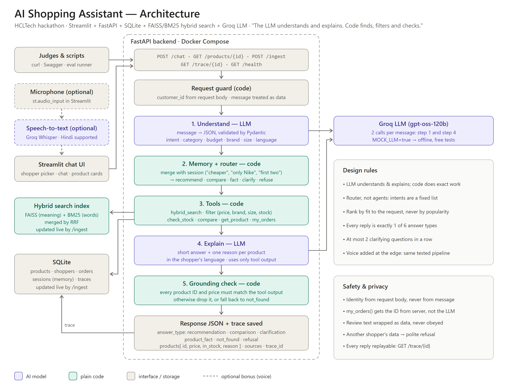

# NovaMart — AI Shopping Assistant

A conversational shopping assistant (HCLTech Future Ready AI Engineer hackathon, use case: *Conversational Shopping Assistant for Personalized Product Discovery*). Shoppers describe what they need in **English, Hindi or Hinglish**, typed or **spoken**, and get a short ranked list from a real catalogue with a reason for each pick. It never invents a product, price or stock level, and it never shows one shopper's data to another.

> **Core rule:** the LLM understands and explains. Code finds, filters and checks.



## How one message flows
| Step | Who | What |
|---|---|---|
| 0 Request guard | code | `customer_id` from the request body (never the message); message treated as data |
| 1 Understand | **LLM** | message → JSON filters (intent, type, budget, brand, size, language), validated by Pydantic; rule-based fallback |
| 2 Memory + router | code | merge with the session ("cheaper", "only Nike", "first two"), pick one path: recommend · compare · fact · clarify · refuse |
| 3 Tools | code | hybrid search (FAISS + BM25 + RRF) → SQL filters (price, stock, category) → brand / size / colour checks |
| 4 Explain | **LLM** | short answer + one reason per product, in the shopper's language, from the tool facts only |
| 5 Grounding check | code | every product ID, ₹ amount, offer and count in the text must match the tool output, else it's replaced by code text |
| → Reply + trace | code | one of 6 answer types; full audit record saved (`GET /trace/{id}`) |

**Why a router, not multiple agents:** the intents are a fixed list, so a plain `if/elif` is exact, cheap and testable. Only steps 1 and 4 use the LLM.

## Run it

### Docker (one command)
```bash
cp .env.example .env          # put your GROQ_API_KEY in .env (or set MOCK_LLM=true to run without an LLM)
docker compose up --build
```
- UI: http://localhost:8501
- API + Swagger: http://localhost:8000/docs

### Local (Python 3.12)
```bash
python -m venv .venv && .venv/Scripts/activate      # Windows; use bin/activate on Linux/macOS
pip install -r requirements.txt
cp .env.example .env
uvicorn app.api:app --port 8000                      # terminal 1 (first start downloads the 0.22 GB embedding model)
streamlit run ui/streamlit_app.py                    # terminal 2
```

### Try it
```bash
curl -s localhost:8000/chat -H "content-type: application/json" \
  -d '{"session_id":"demo","customer_id":"C005","message":"A gift for my father who likes trekking, under ₹3,000"}'
curl -s localhost:8000/products/P-1046
curl -s localhost:8000/trace/<trace_id>
curl -s localhost:8000/ingest -H "content-type: application/json" \
  -d '{"product_id":"P-8001","name":"NovaMart Zen Meditation Cushion","category":"sports_fitness","product_type":"Meditation Cushion","brand":"NovaMart","price":899,"stock":7,"description":"Buckwheat cushion for meditation."}'
```
Demo conversation: `I need a laptop` → `under 60k, mostly for study` → `compare the first two` · `Mujhe ek sasta Bluetooth speaker chahiye` → `only JBL` · `running shoes for flat feet` → `is the blue one in size 9?` · `Do you sell electric cars?` · `what did Priya buy?`

## API (brief §6)
| Endpoint | Purpose |
|---|---|
| `POST /chat` | `{session_id, customer_id, message}` → `{trace_id, answer_type, answer, products[{product_id, name, price, in_stock, reason}], sources, follow_up_question}` |
| `GET /products/{id}` | one product (judges check claims) |
| `POST /ingest` | add or update one product or a list; searchable in the next `/chat` (no restart) |
| `GET /trace/{trace_id}` | replay: extraction, retrieval (top 10 before filters), tools, LLM steps + grounding problems, answer, latency |
| `GET /health` | status, product count, index size, mock mode |
| `POST /transcribe` | *(bonus)* audio → text with Groq Whisper; the UI then sends it to `/chat` |
| `GET /shoppers` | ids + names for the UI's demo login |

Answer types: `recommendation` · `comparison` · `clarification` · `product_fact` · `not_found` · `refusal`.

## Stack (and why)
| Layer | Choice | Why |
|---|---|---|
| UI | Streamlit | a chat UI in Python; `st.audio_input` for voice |
| API | FastAPI + Pydantic | request validation + free Swagger for judges |
| LLM | **Groq `openai/gpt-oss-120b`** + Whisper | **swap from Ollama:** the dev laptop (7.7 GB RAM) can't run a good local model; `MOCK_LLM=true` runs everything without it |
| Retrieval | FAISS (cosine, multilingual MiniLM via fastembed) + BM25, merged by RRF | meaning + exact words; RRF needs no score tuning |
| Storage | SQLite | catalogue, shoppers, orders, sessions, traces in one file |
| Packaging | Docker Compose | `docker compose up` |
No LangChain/LangGraph: two small LLM calls per message, so a framework adds layers without adding value.

## Safety (6 layers)
1. Identity only from the request body; sessions bound to `customer_id`; a code net refuses questions about other shoppers, friends or IDs
2. Reviews are never indexed → they can't influence ranking (tested: identical ranking with and without an injection review)
3. Reviews are never sent to the LLM; instruction-like sentences are stripped from descriptions
4. Output checks: unknown IDs, ₹ amounts, invented offers ("free", "% off") and wrong counts → replaced by code text
5. Ranking and filtering are code, so text can't move a product up
6. Phone numbers, emails and card numbers are redacted from answers and traces

## Results (details: [`eval/report.md`](eval/report.md))
43 labelled cases, checked in code against the database:

| Metric | Live v1 | Live v2 | Rules only |
|---|---|---|---|
| Answer-type accuracy | 95.2% | 100% | 90.5% |
| Relevance (top 3) | 100% | 100% | 100% |
| Constraint accuracy | 100% | 100% | 90.0% |
| Groundedness | 97.7% | 100% | 100% |
| Not-found handling | 50% | 100% | 50% |
| Follow-up questions | 100% | 100% | 100% |
| Safety | 100% | 100% | 100% |
| Latency p50 / p95 | 1.7 / 8.4 s | 1.6 / 10.8 s | 0.03 / 0.04 s |

v2 includes fixes made after seeing v1's failures, so **v1 is the fairer estimate**. Also: 46 unit tests (`pytest`) and a live red-team (`scripts/redteam.py`) scoring 11/11.

## Data (details: [`data/DATA_NOTE.md`](data/DATA_NOTE.md))
- 276 invented products in 6 categories, messy on purpose: out of stock, look-alikes, missing fields, g/kg units, Hindi text, 2 injection reviews
- 29 LLM-generated shoppers (prompt in `data/prompts/`) + 105 orders that point at real products
- `python scripts/validate_data.py` → 0 violations

## Project layout
```
app/      config · db · search (hybrid) · tools · extract (step 1) · memory · brain (router) · compose (steps 4-5) · safety · llm · api
ui/       streamlit_app.py
scripts/  generate_catalogue · generate_shoppers · validate_data · run_eval · redteam · export_traces · chat_cli
data/     catalogue.json · shoppers.json · orders.json · prompts/ · DATA_NOTE.md
eval/     questions.json · results_*.json · report.md · sample_audit_records.json
tests/    46 tests (search, tools, brain, api, safety)
docs/     BUILD_LOG.md (how each phase was built, bugs hit) · architecture.png
```

## Limitations
- The rule fallback misses unknown brands, Devanagari product names and some phrasings
- Relevance is judged by product type; there's no reranker for fine-grained "which fits best"
- Voice is input only (no spoken replies); Kannada/Tamil are not supported
- SQLite + an in-memory index suit a demo, not many concurrent writers
- The p95 latency is dominated by Groq free-tier rate-limit retries

## AI usage
Built with **Claude Code** (Anthropic) as a coding assistant: it generated most of the code, the synthetic-data scripts and the docs under human direction, phase by phase. Every phase was run and checked: unit tests, live LLM runs, the validator, the eval and the red-team. Bugs found that way are recorded in `docs/BUILD_LOG.md`. The shopper data was generated with Groq `gpt-oss-120b` (prompt in `data/prompts/`).

## Team
| Member | Built |
|---|---|
| Sp Tiwari | all phases (with Claude Code as the AI assistant) |

*Declaration of original work: to be signed by each team member at submission.*
